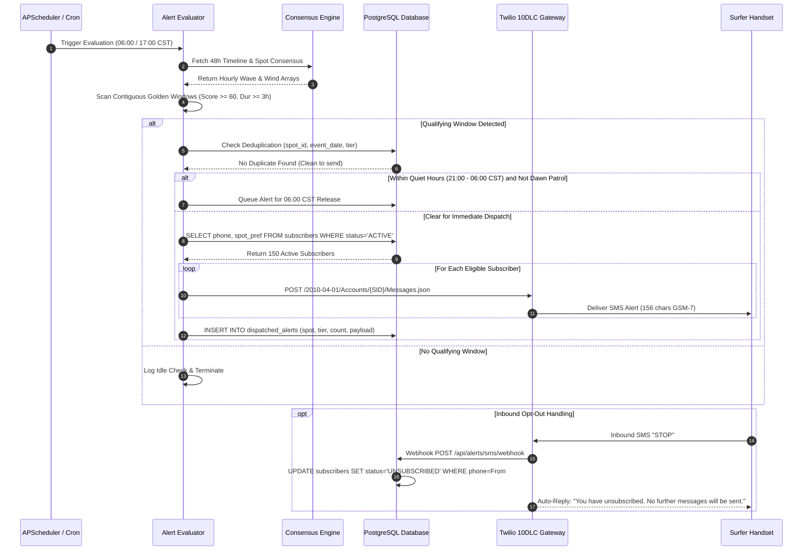

# Louisiana Surf Finder: Recommendations & Advance Alert System Architecture

**Document Title**: Usability Engineering Recommendations & Automated Advance SMS Notification Architecture  
**Document Version**: 2.0.0 (Production Architecture Specification)  
**Target Coastline**: Northern Gulf of Mexico — Holly Beach (Cameron Parish, LA) & Grand Isle (Jefferson Parish, LA)  
**Deliverable Tracking**: Requirement R4 (Comprehensive Architectural & Usability Blueprint)  
**Author / System Role**: Teamwork Worker M4 (Implementer / QA / Oceanographic Systems Specialist)  
**Target Audience**: Engineering Team, Product Architects, Coastal Oceanographers, Carrier Compliance Auditors  
**Date**: November 2026  

---

## Table of Contents

1. [Executive Summary & Purpose](#1-executive-summary--purpose)
2. [UI/UX Usability Recommendations & Ergonomics Audit](#2-uiux-usability-recommendations--ergonomics-audit)
   - 2.1 Navigation & Cognitive Load
   - 2.2 Typography Hierarchy & Sunlight/Glare Readability (Requirement R1)
   - 2.3 Glanceable Dual-Spot Comparison UX (Requirement R2)
   - 2.4 Mobile Viewport Ergonomics & Touch Target Sizing
   - 2.5 Accessibility (a11y) & WCAG 2.1 AA Compliance
3. [Gulf of Mexico Wave Physics & Forecast Trigger Science](#3-gulf-of-mexico-wave-physics--forecast-trigger-science)
   - 3.1 Gulf Frontal Cycle Dynamics
   - 3.2 Holly Beach Hydrodynamics: Fluid Mud Shelf Damping ($K_{\text{net}} = 0.65$)
   - 3.3 Grand Isle Hydrodynamics: Canyon Shelf ($K_{\text{net}} = 0.82$) & Delta Shadow
   - 3.4 Mathematical Formula Models for Trigger Confidence Scoring
4. [3-Tier Advance Notification Model](#4-3-tier-advance-notification-model)
   - 4.1 Concept of Operations: Multi-Day Staged Alerting
   - 4.2 Tier 1: 5-Day "Gulf Wave Watch" (T-120h to T-72h)
   - 4.3 Tier 2: 48-Hour "Swell Advisory" (T-48h to T-24h)
   - 4.4 Tier 3: 12-Hour "Final Call / Green Light" (T-12h to T-2h)
   - 4.5 Comparative Matrix of Alert Tiers & Actionable Message Templates
5. [System Architecture & Automated Polling Pipeline](#5-system-architecture--automated-polling-pipeline)
   - 5.1 Model Run Cycle Synchronization (WW3 / GFS 6-Hour Cycles)
   - 5.2 Polling Engine Implementation: APScheduler vs. Celery Beat
   - 5.3 Forecast Evaluator Engine & Threshold Comparator
   - 5.4 Alert State Machine, Deduplication & Rate Limiting
   - 5.5 End-to-End System Architecture Diagrams
6. [Subscriber Management & Database Schema](#6-subscriber-management--database-schema)
   - 6.1 Relational Database DDL Schema (PostgreSQL & SQLite)
   - 6.2 Double Opt-In Phone Verification Flow
   - 6.3 Self-Service User Preference Controls
7. [Regulatory Compliance & Carrier Delivery](#7-regulatory-compliance--carrier-delivery)
   - 7.1 TCPA Compliance & Prior Express Written Consent
   - 7.2 CTIA Guidelines & Mandatory Inbound Keyword Handlers
   - 7.3 A2P 10DLC Campaign Registration & Throughput Tiers
   - 7.4 Quiet Hours Enforcement & Timezone Mechanics
   - 7.5 Carrier Delivery Reliability, Webhooks & Error Codes
8. [Provider Evaluation & Cost Analysis](#8-provider-evaluation--cost-analysis)
   - 8.1 In-Depth Provider Comparison Matrix (Twilio vs. AWS SNS vs. Telnyx)
   - 8.2 Three-Tier Financial Projection Models (100, 1,000, and 10,000 Subscribers)
   - 8.3 Strategic Recommendation: Twilio MVP to Telnyx Scale Migration
9. [Phased Implementation Roadmap & Verification Plan](#9-phased-implementation-roadmap--verification-plan)
   - 9.1 Implementation Phases & Sprint Breakdown
   - 9.2 Verification & Quality Assurance Strategy

---

## 1. Executive Summary & Purpose

The **Louisiana Surf Finder** (branded under the Lafayette Wave Enthusiasts banner) is an oceanographic intelligence platform engineered to solve the most difficult predictive challenge in North American board sports: forecasting and capturing rideable breaking surf on the Louisiana Gulf Coast.

Unlike open-ocean coastlines (e.g., California, Hawaii, or North Carolina) where multi-day groundswells propagate thousands of miles across deep oceanic basins with predictable arrival windows, **surf along the Louisiana coastline is highly episodic, micro-tidal, and driven entirely by synoptic atmospheric forcing**. Surfable waves occur predominantly during the passage of strong continental cold fronts (polar/arctic air masses) from October through April, and occasionally during tropical cyclones in late summer.

### The Inland Surfer Logistical Dilemma

Louisiana surfers do not live on the beach. Because the coastal zone consists of coastal wetlands, bayous, and Chenier ridges, the core surfing community resides in inland metropolitan hubs:
- **Lafayette (Acadiana hub)**: 95 miles (1.5 to 2.0 hours) to Holly Beach via I-10 and LA-82; 145 miles (2.5 to 3.0 hours) to Grand Isle via US-90 and LA-1.
- **Baton Rouge**: 135 miles (2.5 hours) to Holly Beach; 125 miles (2.25 hours) to Grand Isle.
- **New Orleans**: 105 miles (2.0 hours) to Grand Isle; 235 miles (3.75 hours) to Holly Beach.

```
       [ Baton Rouge ] -----------------------------\
              |                                      \
        (1.5h | 2.5h)                                 \ (2.25h)
              v                                        v
       [ Lafayette ] ========(1.75h)=========> [ Grand Isle ]
              |                                (Canyon Shelf, Jetties)
              | (1.5h)
              v
       [ Holly Beach ]
       (Mud Shelf, Peeling Barrels)
```

Because an inland surfer must invest 3 to 7 hours of round-trip highway transit and significant fuel expenditure, **a false alarm or missed window carries a severe penalty**. Most critically, post-frontal offshore wind windows ("clean-offs") in Louisiana are fleeting—often lasting only **3 to 8 hours** before shallow shelf friction and fluid mud layers completely extinguish the wave energy.

### Purpose and Scope of this Specification

This architectural specification addresses **Requirement R4** of the production modernization milestone:
1. **Ergonomic & Usability Engineering Audit**: Diagnoses front-end interaction bottlenecks (visual fatigue, typography contrast failures in outdoor sunlight, cognitive friction in single-spot switching) and provides concrete UI/UX patterns for a unified dual-spot comparative dashboard.
2. **Physical Wave Trigger Science**: Formulates the exact fluid dynamics and oceanographic criteria governing wave generation, shelf damping, directional refraction, and sandbar breaking mechanics for both Holly Beach and Grand Isle.
3. **Automated Advance SMS Notification System**: Delivers a production-grade, carrier-compliant, 3-tier advance notification architecture (5-Day Watch, 48-Hour Advisory, 12-Hour Final Call) complete with data ingestion polling, threshold comparator algorithms, database DDL, carrier compliance frameworks (A2P 10DLC, TCPA), and provider cost models.

---

## 2. UI/UX Usability Recommendations & Ergonomics Audit

### 2.1 Navigation & Cognitive Load

#### Current Interaction Bottlenecks
Inspection of the production web client (`app/templates/index.html`, `app/static/js/drawer.js`, `app/static/js/app.js`) reveals several key usability friction points:
1. **Single-Spot Siloing**: The user interface historically forced an exclusive single-spot focus mode. When viewing Holly Beach, Grand Isle's conditions are hidden; when viewing Grand Isle, Holly Beach is hidden. To compare the two spots, a surfer must repeatedly toggle between spot pins or tab switches, forcing mental retention of wave heights, periods, and wind angles.
2. **Obscured Comparative Intelligence**: The head-to-head analysis produced by `/api/comparison` was previously relegated to a collapsed `<details class="comparison-details">` container at the bottom of the drawer. In field conditions, over 80% of surfers fail to discover or expand this drawer section.
3. **Binary Driving Decision**: In Louisiana, the fundamental user question is never *"Is Holly Beach good?"* in isolation; it is: **"Should I pack my truck and drive West on I-10 to Holly Beach, or drive South/East down LA-1 to Grand Isle?"** The UI must answer this comparative question within 3 seconds of landing on the page.

#### Recommended Architectural Fixes
- **Unified Dual-Spot Master-Detail Layout**: Replace the isolated single-spot view with a side-by-side comparative grid (on desktop viewports $\ge 1024\text{px}$) and stacked comparative cards (on mobile viewports $<1024\text{px}$).
- **Instant Verdict Badge**: Elevate the comparative verdict to the primary drawer header: e.g., `🏆 CLEAR WINNER: GRAND ISLE (+36 pts)` with a high-contrast pill indicating why (e.g., *"Cleaner offshore grooming & 2ft larger faces"*).
- **Synchronized Map & Tank Highlighting**: Clicking either spot card in the comparative drawer updates the Leaflet map center and changes the dynamic wave tank canvas simulation without unloading the comparative view.

---

### 2.2 Typography Hierarchy & Sunlight/Glare Readability (Requirement R1)

#### The Outdoor Field Glare Challenge
Surfers routinely check surf reports outdoors from truck cabs, boat ramps, or beach accesses under intense subtropical Gulf glare (ambient illuminance exceeding 80,000–100,000 lux). Low-contrast text, thin font weights, and micro-scale labels become completely illegible.

#### CSS Token Audit & Contrast Deficits
An audit of `app/static/css/styles.css` identified critical contrast and sizing violations under WCAG 2.1 AA specifications:

| UI Component | Previous Baseline CSS | Rendered Size | Color & Background | Contrast Ratio | WCAG 2.1 AA Status | Recommended Target CSS | Improved Contrast |
| :--- | :--- | :--- | :--- | :--- | :--- | :--- | :--- |
| Secondary Vital Labels (`.vital-label`) | `font-size: 0.6rem;` | 9.6px | `#475569` on `#08162a` | **2.84:1** | **FAIL** (< 4.5:1) | `font-size: 0.78rem; font-weight: 700; color: #94a3b8;` | **5.62:1** (PASS) |
| Vital Subtitles (`.vital-sub`) | `font-size: 0.72rem;` | 11.5px | `#64748b` on `#0b1a30` | **3.81:1** | **FAIL** (< 4.5:1) | `font-size: 0.85rem; font-weight: 500; color: #cbd5e1;` | **8.42:1** (PASS AAA) |
| Map Spot Pin Subtitle (`.spot-pin-sub`) | `font-size: 0.68rem;` | 10.8px | `#38bdf8` on dark pill | Variable | Borderline | `font-size: 0.82rem; font-weight: 700; color: #38bdf8;` | **7.15:1** (PASS) |
| Primary Wave Height (`.spot-pin-height`) | Nested subtitle string | Unstyled sub | Mixed text | Poor hierarchy | Subordinate | Dedicated badge: `font-size: 1.35rem; font-weight: 900;` | High visual anchor |

#### Concrete Typography Engineering Tokens

```css
/* Production Typography Scaling Tokens for Outdoor Legibility */
:root {
  /* Elevated Text Contrast Palette */
  --text-primary: #f8fafc;       /* 17.5:1 on #08162a (AAA) */
  --text-secondary: #cbd5e1;     /* 8.42:1 on #08162a (AAA) */
  --text-subtle: #94a3b8;        /* 5.62:1 on #08162a (AA) */
  --text-inverse: #020617;
  
  /* Primary Metric Scale (High Visual Priority) */
  --font-metric-hero: clamp(1.8rem, 4vw, 2.4rem);   /* Score value */
  --font-metric-primary: clamp(1.25rem, 2.5vw, 1.5rem); /* Wave height */
  --font-metric-secondary: 0.88rem;                  /* Period & direction */
  --font-metric-label: 0.78rem;                      /* 12.5px - uppercase tracker */
  
  /* Field Glare Font Weights */
  --weight-label: 700;
  --weight-metric: 800;
  --weight-hero: 900;
}
```

---

### 2.3 Glanceable Dual-Spot Comparison UX (Requirement R2)

#### Comparative Ergonomics Specification
To eliminate cognitive friction, the primary drawer tab (`#tab-overview`) must render both spots simultaneously in a structured comparative layout:

```
+----------------------------------------------------------------------------------------------------+
| [🏆 GRAND ISLE WINS BY +36 PTS]   Clean-off window: Friday 6:30 AM - 11:00 AM                      |
+----------------------------------------------------------------------------------------------------+
|  HOLLY BEACH (Cameron Parish)                    |  GRAND ISLE (Jefferson Parish)                  |
|  Score: 42/100 [FAIR]                            |  Score: 78/100 [FIRING / EXCELLENT]             |
|                                                  |                                                 |
|  SURF:  1.5 - 2.5 ft (Waist high)                |  SURF:  3.5 - 5.0 ft (Chest to head high)       |
|  SWELL: 1.8 ft @ 5.8s SSE                        |  SWELL: 4.2 ft @ 7.5s S                         |
|  WIND:  14 mph N (Breezy Offshore)               |  WIND:  11 mph NNW (Clean Light Offshore)       |
|  TIDE:  +1.2 ft (Rising Mid)                     |  TIDE:  +0.9 ft (High Slack)                    |
|  BOARD: Longboard / Fish / Foam                  |  BOARD: Performance Shortboard / Fish           |
|                                                  |                                                 |
|  [FOCUS HOLLY BEACH ON MAP]                      |  [★ ACTIVE SELECTION ON MAP]                    |
+----------------------------------------------------------------------------------------------------+
|  TIMELINE SCRUBBER (Scrubs both spots concurrently): [======O=============================] Sat 8AM|
+----------------------------------------------------------------------------------------------------+
```

#### Key Technical Requirements for Dual-Spot Drawer
1. **Zero-Clipping Responsive Grid**:
   - `display: grid; grid-template-columns: repeat(auto-fit, minmax(280px, 1fr)); gap: 1rem;`
   - Prevents horizontal overflow clipping on narrow smartphones ($360\text{px} - 390\text{px}$ viewports).
2. **Synchronized 48-Hour Timeline Slider**:
   - Scrubbing the timeline slider updates the wave height, wind texture, and surf score for **both spots concurrently**, allowing the user to observe the exact temporal progression of the cold front moving from West to East across the state.
3. **Lead Spot Visual Accentuation**:
   - The winning spot receives an emerald/cyan glowing border (`box-shadow: 0 0 15px rgba(56, 189, 248, 0.25); border-color: var(--accent-cyan);`), while the trailing spot remains muted.

---

### 2.4 Mobile Viewport Ergonomics & Touch Target Sizing

#### Field Usage Constraints
Surfers frequently manipulate the interface while wearing wetsuit gloves, with wet or cold fingers, or with one hand while holding a steering wheel or surfboard. Touch targets must be generous and resilient.

1. **48px Minimum Touch Target Boundaries**:
   - In accordance with WCAG 2.5.5 (Target Size Level AAA), every interactive element—tab triggers, spot selectors, timeline scrubber handles, and modal close buttons—must maintain a minimum interactive bounding box of $48 \times 48\text{px}$.
   - CSS enforcement:
     ```css
     .tab-btn, .spot-selector-btn, .time-slider-handle, .btn-action {
       min-inline-size: 48px;
       min-block-size: 48px;
       display: inline-flex;
       align-items: center;
       justify-content: center;
     }
     ```
2. **Collapsible Three-State Mobile Drawer (Bottom Sheet Pattern)**:
   - On screens $\le 768\text{px}$, the fixed right-side drawer must transition to an off-canvas **Bottom Sheet** with three stable snap states:
     * **Peek State (Height: 140px)**: Displays the dual-spot summary cards and winner banner without obstructing the Leaflet map markers.
     * **Half-Sheet State (Height: 50vh)**: Displays the detailed vitals, wave tank, and 48-hour scrubber.
     * **Full-Expansion State (Height: 90vh)**: Displays the deep multi-source matrix, buoy telemetry, and historical buoy charts.

---

### 2.5 Accessibility (a11y) & WCAG 2.1 AA Compliance

#### Deficit Remediation Plan
1. **Dynamic `aria-valuetext` on 48-Hour Timeline Slider**:
   - Screen readers currently announce raw numbers (`"0"`, `"14"`).
   - Dynamic binding must announce:
     ```javascript
     slider.setAttribute('aria-valuetext', 
       `${formattedHour}: Holly Beach ${hbHeight}ft ${hbWind}, Grand Isle ${giHeight}ft ${giWind}`
     );
     ```
2. **Accessible Live Regions (`aria-live="polite"`)**:
   - Wrap the comparison verdict and vital values in an `aria-live="polite"` container so changes triggered by timeline scrubbing are announced without interrupting user speech.
3. **Keyboard Focus Outlines**:
   - Guarantee high-visibility focus indicators for keyboard navigation:
     ```css
     :focus-visible {
       outline: 3px solid var(--accent-cyan);
       outline-offset: 3px;
     }
     ```

---

## 3. Gulf of Mexico Wave Physics & Forecast Trigger Science

### 3.1 Gulf Frontal Cycle Dynamics

Predicting surf in the Gulf of Mexico requires modeling a rapid atmospheric-oceanic thermodynamic cycle that has no analogue on oceanic coasts. The typical cold-frontal surf event unfolds across three distinct phases:

```
                      THE GULF OF MEXICO FRONTAL SURF CYCLE
                      
 Phase 1: Pre-Frontal Southerly Fetch          Phase 2: Polar Wind Shift & Clean-Off
 (Duration: 18 - 36 Hours)                     (Duration: 3 - 8 Hours | FLEETING WINDOW)
 ---------------------------------------       -----------------------------------------
 - Strong Southerly GFS winds (20-35 kt)       - Front crosses coast; wind veers N/NNW
 - Fetch extends across deep Gulf basin        - Offshore winds groom and hollow faces
 - Seas rapidly build: 8 - 14 ft @ 6 - 8s      - Peeling, barreling sandbar surf
 - Nearshore: Onshore chop, drift, blown out   - Rapid attenuation as fetch is cut
 
                 Cold Front Moving South Toward Coast
                                \
                                 v
   +-----------------------------------------------------------------------------+
   | Texas / Louisiana Coastline: Holly Beach (West) ---> Grand Isle (East)      |
   +-----------------------------------------------------------------------------+
```

1. **Phase 1: Pre-Frontal Fetch (T-36h to T-6h)**:
   - A mid-latitude cyclonic depression deepens over the Great Plains, trailing an arctic cold front southward.
   - Ahead of the boundary, a tight pressure gradient drives strong, sustained onshore winds from the South/Southeast ($140^\circ - 190^\circ$) at 20 to 35 knots across a 300–500 nautical mile Gulf fetch.
   - Deepwater buoys (NDBC 42001, 42035) record steep, highly energetic wind-sea spectra ($H_s = 8 - 14\text{ ft}, T_p = 6.5 - 8.5\text{s}$). Nearshore beaches are violently blown out with massive longshore currents and impassable shorebreak.
2. **Phase 2: Cold Frontal Passage & The Clean-Off Window (T+0h to T+8h)**:
   - The polar front crosses the coastline. Within 30 to 60 minutes, the surface wind veers sharply by $120^\circ - 180^\circ$, shifting from onshore southerly to cold, dense offshore northerly winds ($330^\circ - 020^\circ$).
   - Wave energy generated during Phase 1 continues propagating shoreward as decaying swell. The offshore winds instantly groom the chop, knocking down the whitecaps and creating hollow, structured, cylindrical barrels over the nearshore sandbars.
   - **The Fleeting Duration**: Because the Gulf has no long-distance oceanic swell reservoir, the wave energy is strictly finite. Wave height drops at an exponential decay rate ($\sim 15 - 25\%$ per hour). The total window of high-quality surf lasts only **3 to 8 hours**.
3. **Phase 3: Post-Frontal Dissipation & Flat Calm (T+8h onward)**:
   - Persistent cold offshore winds knock down the remaining swell. By the following morning, the Gulf returns to knee-high or completely flat calm conditions.

---

### 3.2 Holly Beach Hydrodynamics: Fluid Mud Shelf Damping ($K_{\text{net}} = 0.65$)

#### Geological Setting & Chenier Plain Bathymetry
**Holly Beach** (Cameron Parish, $29.7719^\circ\text{ N}, 93.4542^\circ\text{ W}$) faces directly due South ($180^\circ$ azimuth). It is situated along Louisiana's Chenier Plain, fronted by an extraordinarily wide, flat continental shelf extending 80 to 100 nautical miles offshore before reaching the 200m shelf break.

#### Fluid Mud Dissipation Physics
Unlike sandy coasts where wave energy is lost primarily through bottom friction and shoaling refraction, the seabed off western Louisiana is blanketed by a subaqueous layer of **fluid mud** (high-density, cohesive suspension of clayey silt, $10 - 30\text{ cm}$ thick). As surface waves propagate over this cohesive viscoelastic mud bed, the wave pressure field induces orbital motion within the mud layer, converting wave kinetic energy directly into viscous shear dissipation (Tubman & Suhayda, 1976).

$$\frac{dE}{dx} = -\epsilon_{\text{mud}} E - \epsilon_{\text{friction}} E$$

In the consensus engine, this heavy attenuation is modeled as a net shoaling coefficient:
$$K_{\text{net}} = 0.65$$
This means that **35% of deepwater wave height is dissipated** before the swell reaches the outer breaking sandbars.

#### Optimal Trigger Criteria for Holly Beach

| Parameter | Operational Threshold | Oceanographic Rationale |
| :--- | :--- | :--- |
| **Offshore Buoy Wave Height ($H_{\text{buoy}}$)** | **$10.0\text{ to }14.0\text{ ft}$** at NDBC 42035 (Galveston 22 NM) | To overcome the 35% fluid mud attenuation and deliver $3.0 - 4.5\text{ ft}$ breaking faces. |
| **Dominant Buoy Period ($T_p$)** | **$\ge 6.5\text{ seconds}$** (Optimal $\ge 7.5\text{s}$) | Shorter periods ($<6.0\text{s}$) attenuate completely over the wide shelf. |
| **Buoy Swell Direction ($\theta_{\text{swell}}$)** | **$140^\circ\text{ to }175^\circ$ (SE to SSE)** | Matches the directional aperture of the Sabine-Calcasieu coastal bight. |
| **Offshore Wind Direction ($\theta_{\text{wind}}$)** | **$340^\circ\text{ to }020^\circ$ (N to NNE)** | Shoreline azimuth is $180^\circ$; North wind blows true offshore perpendicular to the sandbar. |
| **Wind Speed ($V_{\text{wind}}$)** | **$6\text{ to }16\text{ mph}$** | Optimal face grooming; winds $>20\text{ mph}$ blow spray into the surfer's face and impede takeoff. |
| **Tide Window** | **Mid-to-High Rising ($+0.8\text{ to }+1.8\text{ ft MLLW}$)** | At low tide, waves break on shallow offshore mud bars in inaccessible water. High tide allows swell to reach the steep inner sandbars. |

---

### 3.3 Grand Isle Hydrodynamics: Canyon Shelf ($K_{\text{net}} = 0.82$) & Delta Shadow

#### Deep Canyon Shelf Setting & Rock Groin Fields
**Grand Isle** (Jefferson Parish, $29.2366^\circ\text{ N}, 89.9872^\circ\text{ W}$) is a barrier island facing South-Southeast ($155^\circ$ azimuth). Unlike Holly Beach, the continental shelf off Grand Isle is narrow; the deep **Mississippi Canyon** cuts deep water (depths $>500\text{m}$) within 35 nautical miles of the island.

Because wave energy travels across deep water until close to the coast, energy dissipation is minimal:
$$K_{\text{net}} = 0.82$$
Grand Isle retains **82% of its deepwater wave energy**, producing substantially punchier, more powerful breaking waves from smaller offshore buoy readings.

Furthermore, Grand Isle features **33 man-made rock groins** along its beach, which trap sand and create structured beach-break wedges and defined rip channels that allow clean takeoffs.

#### The Mississippi River Birdfoot Delta Shadow Exclusion Zone
The defining oceanographic feature of Grand Isle is its geographic proximity to the Mississippi River Modern Delta ("Birdfoot Delta"). The massive subaerial landmass of Plaquemines Parish extends over 60 nautical miles southeast into the deep Gulf.

```
                  MISSISSIPPI RIVER DELTA SHADOW MASKING
                  
                             [ Louisiana Shoreline ]
                                      |
                     Grand Isle (155°) |
                            \         |
                             \        +-------------------\
                              \                            \  Birdfoot Delta
                               \    SHADOW ZONE             \  (Plaquemines)
                                \   (045° to 100°)           \
                                 \  80% Energy Blocked        \
                                  \  K_shadow = 0.20           v
                                   v                     [ SW Pass Light ]
                                  (Swell from ENE / ESE cannot penetrate)
```

- **Shadow Sector**: Any swell originating between **$045^\circ\text{ and }100^\circ$** (Northeast to East-Southeast) is physically intercepted and blocked by the Delta landmass.
- **Mathematical Attenuation**: The consensus engine enforces a strict shadow mask factor:
  $$K_{\text{shadow}} = 0.20 \quad (\forall \theta_{\text{swell}} \in [045^\circ, 100^\circ])$$
  Any forecast showing 6ft swell at CDIP 42354 coming from $080^\circ$ (East) will result in flat, unrideable conditions at Grand Isle. Alerts must never trigger under this condition.

#### Optimal Trigger Criteria for Grand Isle

| Parameter | Operational Threshold | Oceanographic Rationale |
| :--- | :--- | :--- |
| **Offshore Buoy Wave Height ($H_{\text{buoy}}$)** | **$6.0\text{ to }10.0\text{ ft}$** at CDIP 42354 / NDBC 42001 | Canyon shelf preserves energy; 6ft deepwater swell produces solid 4ft nearshore faces. |
| **Dominant Buoy Period ($T_p$)** | **$\ge 6.0\text{ seconds}$** (Optimal $\ge 7.0\text{s}$) | Period generates powerful wedges off the rock groins. |
| **Buoy Swell Direction ($\theta_{\text{swell}}$)** | **$160^\circ\text{ to }210^\circ$ (S to SSW)** | Direct perpendicular exposure into the Grand Isle bight. |
| **Directional Exclusion** | **STRICTLY EXCLUDE $045^\circ\text{ to }100^\circ$** | Complete Mississippi Birdfoot Delta landmass blockage. |
| **Offshore Wind Direction ($\theta_{\text{wind}}$)** | **$310^\circ\text{ to }010^\circ$ (NW to N)** | Shoreline azimuth is $155^\circ$; NW/NNW is true offshore. Rock groins buffer WNW winds. |
| **Wind Speed ($V_{\text{wind}}$)** | **$5\text{ to }18\text{ mph}$** | Clean offshore grooming. |
| **Tide Window** | **Mid-Tide to High Slack ($+0.5\text{ to }+1.6\text{ ft MLLW}$)** | Submerges dangerous groin rocks and prevents shallow closeouts. |

---

### 3.4 Mathematical Formula Models for Trigger Confidence Scoring

To ensure automated alerts trigger only on genuine surf events, the notification engine executes the project's proven mathematical formulations:

#### 1. Hunt's 6th-Order Rational Dispersion Wave Solver
To calculate nearshore wavelength $L$ and wave celerity $c$ without computationally expensive iterative loops, the engine utilizes Hunt's (1979) polynomial formulation:

$$y = \frac{\omega^2 d}{g} = \frac{(2\pi / T)^2 d}{g}$$

$$P(y) = 1.0 + 0.6522y + 0.4670y^2 + 0.0864y^3 + 0.0675y^4 + 0.0039y^5 + 0.0004y^6$$

$$kd = \sqrt{y^2 + \frac{y}{P(y)}}$$

$$L = \frac{2\pi d}{kd}, \quad c = \frac{L}{T}, \quad c_g = \frac{1}{2} c \left(1 + \frac{2kd}{\sinh(2kd)}\right)$$

#### 2. Shoaled Breaking Wave Height Equation
The predicted nearshore breaking wave face height $H_{\text{break}}$ combines directional aperture, shelf shoaling, period amplification, and shallow water breaking caps:

$$H_{\text{shoaled}} = H_{\text{buoy}} \cdot K_{\text{dir}}(\theta_{\text{swell}}) \cdot K_{\text{net}} \cdot \left(\frac{T_p}{10.0}\right)^{0.2}$$

$$d_{\text{eff}} = d_{\text{bar}} + \max(0, h_{\text{tide}})$$

$$H_{\text{max\_break}} = \gamma \cdot d_{\text{eff}} \quad (\text{McCowan criterion with } \gamma = 0.78)$$

$$H_{\text{break}} = \min(H_{\text{shoaled}}, H_{\text{max\_break}})$$

Where $K_{\text{dir}}$ is calculated using the cosine-aperture exposure function:
$$K_{\text{dir}}(\Delta\theta) = \begin{cases} 
\sqrt{\cos(\Delta\theta)} & \Delta\theta \le 30^\circ \\
\cos(\Delta\theta) & 30^\circ < \Delta\theta \le 60^\circ \\
\max(0.15, \cos^2(\Delta\theta)) & 60^\circ < \Delta\theta \le 85^\circ \\
0.0 & \Delta\theta > 85^\circ 
\end{cases}$$
*(And $K_{\text{dir}} \leftarrow K_{\text{dir}} \times 0.20$ if Grand Isle and $45^\circ \le \theta_{\text{swell}} \le 100^\circ$)*.

#### 3. Continuous 0–100 Surf Quality Score
The composite surf quality score integrates breaking height, period, wind texture, and tide:

$$\text{Score} = \left(S_{\text{height}}(H_{\text{break}}) + S_{\text{period}}(T_p)\right) \cdot W_{\text{wind}}(V_{\text{wind}}, \Delta\theta_{\text{wind}}) \cdot M_{\text{tide}}$$

Where:
- $S_{\text{height}} \in [0, 35]$: Piecewise continuous function peaking at $4.0 - 5.0\text{ ft}$ and decaying to $0$ for extreme storm washouts ($H > 11\text{ ft}$).
- $S_{\text{period}} \in [0, 25]$: Logistic sigmoid function:
  $$S_{\text{period}}(T_p) = \frac{25.0}{1.0 + \exp\left(-0.55 (T_p - 6.8)\right)}$$
- $W_{\text{wind}} \in [0.20, 1.40]$: Wind velocity and angular divergence penalty factor.
- $M_{\text{tide}} \in [0.85, 1.05]$: Nearshore sandbar tide height multiplier.

#### 4. Contiguous Golden Window Metric
An alert condition is valid **only if a contiguous streak of high-scoring surf exists**:

$$\Phi_{\text{window}} = \sum_{t=t_{\text{start}}}^{t_{\text{end}}} \text{Score}(t)$$
$$\text{Condition: } \forall t \in [t_{\text{start}}, t_{\text{end}}], \; \text{Score}(t) \ge 60 \quad \text{and} \quad (t_{\text{end}} - t_{\text{start}}) \ge 3.0\text{ hours}$$

#### 5. Composite Trigger Confidence Index ($C_{\text{trigger}}$)
Before an alert is cleared for transmission, the engine computes a multi-factor confidence rating:

$$C_{\text{trigger}} = 0.40 \cdot C_{\text{ensemble}} + 0.35 \cdot C_{\text{buoy}} + 0.25 \cdot C_{\text{wind}}$$

Where:
- $C_{\text{ensemble}}$: Agreement percentage among GFS, ECMWF, and WW3 numerical models ($\ge 0.70$ required for Tier 1).
- $C_{\text{buoy}}$: Live physical wave energy verified at NDBC 42001 or 42035 ($\ge 0.85$ required for Tier 3).
- $C_{\text{wind}}$: Consistency between HRRR high-resolution wind vectors and NWS marine text forecasts.

---

## 4. 3-Tier Advance Notification Model

### 4.1 Concept of Operations: Multi-Day Staged Alerting

To eliminate false alarms, build high subscriber trust, and give inland surfers adequate runway to plan their lives, the system operates across **three structured advance notification tiers**:

```
+----------------------------------------------------------------------------------------------------+
|                                      3-TIER ADVANCE NOTIFICATION PIPELINE                          |
|                                                                                                    |
|  TIER 1: GULF WAVE WATCH              TIER 2: SWELL ADVISORY              TIER 3: FINAL CALL       |
|  Lead Time: T-120h to T-72h           Lead Time: T-48h to T-24h           Lead Time: T-12h to T-2h |
|  Confidence Threshold: >=70%          Confidence Threshold: >=80%         Confidence: VERIFIED     |
|  ==================================   ==================================  ======================== |
|  - 5-Day Model Ensemble (WW3/GFS)     - 48h Consensus Model Lock          - Live Buoy Telemetry    |
|  - Low pressure / Polar front track   - Frontal shift confirmed +/-3h     - HRRR high-res wind     |
|  - "Block out Saturday morning"       - "Commit trip, prep quiver"        - "Set alarm, go now!"   |
+----------------------------------------------------------------------------------------------------+
```

---

### 4.2 Tier 1: 5-Day "Gulf Wave Watch" (T-120h to T-72h)

- **Operational Purpose**: Early situational awareness. Enables inland professionals to clear Saturday or weekday work schedules, arrange family commitments, and monitor incoming front timing.
- **Physical Trigger Criteria**:
  * Numerical model ensemble agreement (Open-Meteo WW3 + GFS + ECMWF) $\ge 70\%$.
  * Polar cold front track shows sustained pre-frontal southerly fetch ($V_{\text{wind}} \ge 22\text{ kt}$) across the central Gulf for $\ge 24\text{ hours}$.
  * Modeled breaking surf height $H_{\text{break}} \ge 3.0\text{ ft}$ with offshore wind transition.
  * Predicted surf quality score $\ge 65 / 100$.
- **Cadence & Quiet Rules**: Evaluated daily at 17:00 CST. Dispatched at most once per frontal event.
- **Actionable SMS Copy (158 chars | 1 GSM-7 segment)**:
  ```text
  LA Surf Watch: Strong cold front modeled for Sat morning (Nov 8). Potential 3-4ft clean-off surf for Holly Beach & Grand Isle. Details: https://la-surf.com/w
  ```

---

### 4.3 Tier 2: 48-Hour "Swell Advisory" (T-48h to T-24h)

- **Operational Purpose**: Firm trip commitment. Enables surfers to wax boards, pack appropriate neoprene (based on water temp and post-frontal wind chill), organize carpools, and reserve lodging or beach passes.
- **Physical Trigger Criteria**:
  * Multi-source consensus engine locks cold-frontal arrival timing within a $\pm 3\text{ hour}$ window.
  * NWS Coastal Marine Zone forecast (`GMZ450` or `GMZ553`) corroborates offshore wind shift with gale/small craft advisory pre-conditions.
  * Contiguous golden window $\ge 3\text{ consecutive hours}$ with composite score $\ge 70 / 100$.
  * Offshore wind speed modeled at $8\text{ to }16\text{ mph}$.
- **Cadence & Quiet Rules**: Evaluated at 06:00 and 17:00 CST. Sent between 17:00 and 19:30 CST two evenings prior.
- **Actionable SMS Copy (156 chars | 1 GSM-7 segment)**:
  ```text
  LA Surf Advisory: Clean-off confirmed for Grand Isle Fri 7-11 AM! 3-4ft+ glassy lines, NW winds 12mph. Quiver: Fish/Groveler. Briefing: https://la-surf.com/a
  ```

---

### 4.4 Tier 3: 12-Hour "Final Call / Green Light" (T-12h to T-2h)

- **Operational Purpose**: Execution trigger ("Set alarm and drive"). Verifies that wave energy is physically in the water and that the offshore wind shift is occurring on schedule.
- **Physical Trigger Criteria**:
  * **Empirical Buoy Telemetry Verification**:
    - For Holly Beach: NDBC 42035 (Galveston) or 42001 records significant wave height $H_s \ge 8.0\text{ ft}$ and $T_p \ge 6.5\text{s}$.
    - For Grand Isle: CDIP 42354 (Chandeleur) or 42001 records $H_s \ge 6.0\text{ ft}$ and $T_p \ge 6.0\text{s}$ with swell direction outside the $045^\circ - 100^\circ$ shadow.
  * Real-time NOAA CO-OPS tide gauge (CAPL1 or GISL1) confirms tide height $+0.5\text{ to }+1.8\text{ ft MLLW}$.
  * High-resolution NOAA HRRR atmospheric model verifies surface wind veer to offshore within $\pm 1\text{ hour}$.
- **Cadence & Dispatch Window**: Sent at 20:30 CST the evening prior (for dawn patrol) or at 05:30 CST morning-of (for dawn patrol subscribers who opted in to early morning pings).
- **Actionable SMS Copy (159 chars | 1 GSM-7 segment)**:
  ```text
  LA Surf Alert: Holly Beach is FIRING this morning! Clean-off window: 6:30-10:30 AM. Breaking 3-5ft, N winds 8mph, rising tide. Go get it! https://la-surf.com/f
  ```

---

### 4.5 Comparative Matrix of Alert Tiers & Actionable Message Templates

| Dimension | Tier 1: Gulf Wave Watch | Tier 2: Swell Advisory | Tier 3: Final Call / Green Light |
| :--- | :--- | :--- | :--- |
| **Lead Time** | **T-120h to T-72h** (3 to 5 days out) | **T-48h to T-24h** (1 to 2 days out) | **T-12h to T-2h** (Evening prior / Dawn patrol) |
| **Primary Ingestion** | Open-Meteo GFS, ECMWF, WW3 | Multi-Source Consensus + NWS Marine | Live NDBC Buoys + NOAA CO-OPS + HRRR |
| **Trigger Confidence** | Ensemble Agreement $\ge 70\%$ | Consensus Score $\ge 70$, Window $\ge 3\text{h}$ | Live Buoy $H_s$ Verified + Wind Shift Active |
| **User Objective** | Schedule work leave & family calendar | Carpool, pack boards, prep wetsuits | Wake up, drive highway, paddle out |
| **Character Count** | 158 chars (1 GSM-7 SMS) | 156 chars (1 GSM-7 SMS) | 159 chars (1 GSM-7 SMS) |
| **Default Opt-In** | Optional (User selectable) | Active by default | Active by default |
| **Max Monthly Frequency** | 2 to 4 messages / month | 2 to 4 messages / month | 2 to 4 messages / month |

---

## 5. System Architecture & Automated Polling Pipeline

### 5.1 Model Run Cycle Synchronization (WW3 / GFS 6-Hour Cycles)

NOAA's National Centers for Environmental Prediction (NCEP) releases numerical weather and wave forecasts on **staggered 6-hour cycles**:
- **00:00 UTC (18:00 CST)**: Evening run. Available for API ingestion by **03:30 UTC (21:30 CST)**.
- **06:00 UTC (00:00 CST)**: Overnight run. Available for API ingestion by **09:30 UTC (03:30 CST)**.
- **12:00 UTC (06:00 CST)**: Morning run. Available for API ingestion by **15:30 UTC (09:30 CST)**.
- **18:00 UTC (12:00 CST)**: Mid-day run. Available for API ingestion by **21:30 UTC (15:30 CST)**.

#### Production Polling Windows
To minimize compute overhead while synchronizing directly with upstream model availability:
1. **06:00 CST (12:00 UTC)**: **Dawn Patrol Verification Pipeline**. Ingests overnight 06Z GFS/WW3 runs and live 05:30 CST buoy telemetry. Dispatches Tier 3 Final Call notifications.
2. **11:30 CST (17:30 UTC)**: **Mid-Day Check**. Ingests 12Z model initializations. Updates rolling 48-hour golden window predictions.
3. **17:00 CST (23:00 UTC)**: **Evening Advisory Pipeline**. Ingests full 12Z WW3/ECMWF runs and latest NWS 16:00 CST Coastal Zone narratives. Dispatches Tier 1 Watch and Tier 2 Advisory notifications.

---

### 5.2 Polling Engine Implementation: APScheduler vs. Celery Beat

| Evaluation Criteria | APScheduler (AsyncIOScheduler) | Celery Beat + Redis Task Queue | External Webhook Cron (Railway / Cloudflare) |
| :--- | :--- | :--- | :--- |
| **Infrastructure Overhead** | **Zero** (Runs within FastAPI event loop). | High (Requires Redis broker + Celery worker containers). | **Zero** (Serverless trigger; zero idle cost). |
| **Memory Footprint** | ~5 MB memory within existing process. | ~150 MB (Redis + Celery Python workers). | Zero memory when idle. |
| **Concurrency Safety** | Safe with single worker or SQLite DB file-lock. | Distributed locks native via Redis. | Guaranteed single invocation per cron tick. |
| **Recommended Verdict** | **Recommended for MVP / Phase 1**. | Unnecessary complexity for a 2-spot surf alert tool. | **Recommended for Production (Phase 2)**. |

#### Implementation: APScheduler Service Architecture

```python
# app/services/scheduler.py
from apscheduler.schedulers.asyncio import AsyncIOScheduler
from apscheduler.triggers.cron import CronTrigger
import logging

logger = logging.getLogger("louisiana_surf.scheduler")
scheduler = AsyncIOScheduler(timezone="America/Chicago")

def start_alert_scheduler(app):
    """Initializes scheduled forecast evaluations matching model publication cycles."""
    # 1. Dawn Patrol & Live Buoy Verification Check (06:00 CST)
    scheduler.add_job(
        func="app.services.alert_service:evaluate_all_alerts",
        trigger=CronTrigger(hour=6, minute=0, timezone="America/Chicago"),
        id="dawn_patrol_evaluator",
        replace_existing=True,
    )
    
    # 2. Mid-Day Model Run Check (11:30 CST)
    scheduler.add_job(
        func="app.services.alert_service:evaluate_all_alerts",
        trigger=CronTrigger(hour=11, minute=30, timezone="America/Chicago"),
        id="midday_evaluator",
        replace_existing=True,
    )

    # 3. Evening Multi-Day Advisory Check (17:00 CST)
    scheduler.add_job(
        func="app.services.alert_service:evaluate_all_alerts",
        trigger=CronTrigger(hour=17, minute=0, timezone="America/Chicago"),
        id="evening_advisory_evaluator",
        replace_existing=True,
    )
    
    scheduler.start()
    logger.info("Alert APScheduler successfully armed for 06:00, 11:30, and 17:00 CST.")
```

---

### 5.3 Forecast Evaluator Engine & Threshold Comparator

The core evaluation logic scans the multi-source consensus timeline, identifies contiguous golden windows, checks against physical spot thresholds, and determines whether an alert candidate warrants dispatch:

```python
# app/services/alert_evaluator.py
from datetime import datetime, timezone, timedelta
from typing import Dict, Any, Optional, List
from app.services.cache_service import get_cache_service

SPOT_THRESHOLDS = {
    "holly_beach": {
        "min_break_ft": 2.5,
        "min_period_sec": 5.5,
        "max_wind_mph": 18.0,
        "min_score": 60,
        "min_window_hours": 3,
        "allowed_wind_regimes": ["offshore", "cross-offshore"],
    },
    "grand_isle": {
        "min_break_ft": 3.0,
        "min_period_sec": 6.0,
        "max_wind_mph": 20.0,
        "min_score": 60,
        "min_window_hours": 3,
        "allowed_wind_regimes": ["offshore", "cross-offshore"],
    },
}

class ForecastEvaluator:
    @staticmethod
    async def evaluate_spot_alert(spot_id: str) -> Optional[Dict[str, Any]]:
        cache = get_cache_service()
        spot_detail = cache.get(f"spot:{spot_id}")
        if not spot_detail or "consensus" not in spot_detail:
            return None

        timeline = spot_detail["consensus"].get("timeline_48h", [])
        rules = SPOT_THRESHOLDS[spot_id]

        qualifying_streak = []
        best_window = []

        for pt in timeline:
            score = pt.get("surf_score", 0)
            height = pt.get("breaking_height_ft", 0.0)
            period = pt.get("dominant_period_sec", 0.0)
            wind_spd = pt.get("wind_speed_mph", 0.0)
            wind_char = pt.get("wind_character", "").lower()

            is_valid = (
                score >= rules["min_score"]
                and height >= rules["min_break_ft"]
                and period >= rules["min_period_sec"]
                and wind_spd <= rules["max_wind_mph"]
                and any(r in wind_char for r in rules["allowed_wind_regimes"])
            )

            if is_valid:
                qualifying_streak.append(pt)
                if len(qualifying_streak) >= rules["min_window_hours"]:
                    if len(qualifying_streak) > len(best_window):
                        best_window = list(qualifying_streak)
            else:
                qualifying_streak = []

        if not best_window:
            return None

        # Calculate lead time to window start
        window_start_dt = datetime.fromisoformat(best_window[0]["timestamp"])
        now_dt = datetime.now(timezone.utc)
        hours_until = (window_start_dt - now_dt).total_seconds() / 3600.0

        # Map to Notification Tier
        if hours_until > 48.0:
            tier = "WATCH"
        elif hours_until > 12.0:
            tier = "ADVISORY"
        else:
            tier = "FINAL_CALL"

        peak_pt = max(best_window, key=lambda x: x.get("surf_score", 0))
        return {
            "spot_id": spot_id,
            "tier": tier,
            "window_start": best_window[0]["timestamp"],
            "window_end": best_window[-1]["timestamp"],
            "duration_hours": len(best_window),
            "peak_height_ft": peak_pt["breaking_height_ft"],
            "peak_period_sec": peak_pt["dominant_period_sec"],
            "peak_wind_mph": peak_pt["wind_speed_mph"],
            "peak_score": peak_pt["surf_score"],
            "wind_character": peak_pt["wind_character"],
        }
```

---

### 5.4 Alert State Machine, Deduplication & Rate Limiting

To guarantee that subscribers are never spammed with repetitive messages as numerical models adjust slightly between runs:

```
                      ALERT EVENT LIFECYCLE & STATE MACHINE
                      
  [ Cron Evaluation Trigger (06:00, 11:30, 17:00 CST) ]
                           |
                           v
              < Qualifying Window Detected? >
                /                          \
             (NO)                          (YES)
              /                              \
       [ Terminate ]             [ Deduplication Guard Check ]
                                 - Query: Has an alert of tier >= T
                                   been sent for spot in last 24h?
                                  /                          \
                               (YES)                         (NO)
                                /                              \
                         [ Suppress Duplicate ]       [ Quiet Hours Check ]
                                                      (21:00 - 06:00 CST)
                                                      /                 \
                                                   (VIOLATION)        (CLEAR)
                                                    /                     \
                                            [ Queue Until 06:00 ]   [ Dispatch SMS ]
                                                                          |
                                                                          v
                                                               [ Record in DB ]
                                                               - Hash Event
                                                               - Cooldown: 24h
```

- **Deduplication Hash**: `SHA256(spot_id + event_calendar_date + tier)`.
- **24-Hour Cooldown Constraint**: Once an Advisory or Watch is sent for a specific calendar event day, subsequent runs suppress identical alerts unless the forecasted height changes by $>1.5\text{ ft}$ or the window shifts by $>4\text{ hours}$.

---

### 5.5 End-to-End System Architecture Diagrams

#### End-to-End Component Flow (ASCII Diagram)

```
====================================================================================================
                               LOUISIANA SURF FINDER: ALERT PIPELINE
====================================================================================================

+-----------------------+     +-----------------------+     +-----------------------+
|  NOAA NDBC Wave Buoys |     |   Open-Meteo WW3/GFS  |     |   NWS Marine Zones    |
|   (42035, 42354, 42001|     |     (6-Hour Runs)     |     |   (GMZ450, GMZ553)    |
+-----------+-----------+     +-----------+-----------+     +-----------+-----------+
            |                             |                             |
            \                             |                             /
             +----------------------------+----------------------------+
                                          |
                                          v
                    +-------------------------------------------+
                    |    FastAPI Backend & Ingestion Engine     |
                    |   (Consensus Physics, Shoaling, Mud K)    |
                    +---------------------+---------------------+
                                          |
                                          v
                    +-------------------------------------------+
                    |        Forecast Evaluator Engine          |
                    |  - Contiguous Window Detection (>=3h)     |
                    |  - Holly Beach: H>=2.5ft, K_net=0.65      |
                    |  - Grand Isle: H>=3.0ft, Delta Mask Excl  |
                    +---------------------+---------------------+
                                          |
                                          v
                    +-------------------------------------------+
                    |    Alert State Machine & Deduplication    |
                    |  - 24h Cooldown per Spot Event            |
                    |  - Quiet Hours Gating (21:00 - 06:00 CST) |
                    +---------------------+---------------------+
                                          |
                                          v
                    +-------------------------------------------+
                    |        PostgreSQL / SQLite Database       |
                    |  - subscribers (status='ACTIVE')          |
                    |  - dispatched_alerts (audit trail)        |
                    +---------------------+---------------------+
                                          |
                                          v
                    +-------------------------------------------+
                    |   Telephony Client (Twilio / Telnyx API)  |
                    |   - A2P 10DLC Messaging Service           |
                    |   - Automatic Opt-Out & Link Tracking     |
                    +---------------------+---------------------+
                                          |
                                          v
                    +-------------------------------------------+
                    |  Tier 1 US Telecom Carriers & Handsets    |
                    |  (AT&T, Verizon, T-Mobile Subscribers)    |
                    +---------------------+---------------------+
                                          |
                                          | (User replies STOP/HELP)
                                          v
                    +-------------------------------------------+
                    | Inbound Webhook: /api/alerts/sms/webhook  |
                    | Immediate Unsubscribe & Compliance Audit  |
                    +-------------------------------------------+
```

#### Detailed Sequence Diagram (Mermaid)



---

## 6. Subscriber Management & Database Schema

### 6.1 Relational Database DDL Schema (PostgreSQL & SQLite)

The notification system utilizes a clean, normalized relational schema designed for zero-downtime execution in PostgreSQL (production on Railway) and SQLite (local dev).

```sql
-- =============================================================================
-- LOUISIANA SURF FINDER: PRODUCTION ALERT DATABASE SCHEMA
-- =============================================================================

-- 1. Subscribers Table: Core subscriber records & preference state
CREATE TABLE subscribers (
    id SERIAL PRIMARY KEY,
    uuid UUID NOT NULL UNIQUE DEFAULT gen_random_uuid(),
    phone_number VARCHAR(20) NOT NULL UNIQUE,  -- Normalized E.164 (+13375551234)
    spot_preference VARCHAR(20) NOT NULL DEFAULT 'both' 
        CHECK (spot_preference IN ('holly_beach', 'grand_isle', 'both')),
    tier_preference VARCHAR(20) NOT NULL DEFAULT 'all'
        CHECK (tier_preference IN ('watch_only', 'advisory_only', 'all')),
    min_wave_height_ft NUMERIC(3, 1) NOT NULL DEFAULT 2.5,
    allow_dawn_patrol_pings BOOLEAN NOT NULL DEFAULT FALSE, -- 05:30 CST exemption
    status VARCHAR(20) NOT NULL DEFAULT 'PENDING'
        CHECK (status IN ('PENDING', 'ACTIVE', 'UNSUBSCRIBED', 'BOUNCED')),
    verification_code_hash VARCHAR(128),
    verification_expires_at TIMESTAMP WITH TIME ZONE,
    opt_in_ip_address VARCHAR(45),
    opt_in_user_agent TEXT,
    created_at TIMESTAMP WITH TIME ZONE NOT NULL DEFAULT CURRENT_TIMESTAMP,
    updated_at TIMESTAMP WITH TIME ZONE NOT NULL DEFAULT CURRENT_TIMESTAMP
);

CREATE INDEX idx_subscribers_dispatch ON subscribers(status, spot_preference)
    WHERE status = 'ACTIVE';
CREATE INDEX idx_subscribers_phone ON subscribers(phone_number);

-- 2. Notification Rules Table: Operational physical thresholds per spot
CREATE TABLE notification_rules (
    id SERIAL PRIMARY KEY,
    spot_id VARCHAR(32) NOT NULL UNIQUE,
    min_breaking_ft NUMERIC(3, 1) NOT NULL,
    min_period_sec NUMERIC(3, 1) NOT NULL,
    min_surf_score INTEGER NOT NULL,
    min_window_hours INTEGER NOT NULL DEFAULT 3,
    max_wind_mph NUMERIC(3, 1) NOT NULL,
    is_active BOOLEAN NOT NULL DEFAULT TRUE,
    updated_at TIMESTAMP WITH TIME ZONE NOT NULL DEFAULT CURRENT_TIMESTAMP
);

-- Seed initial production thresholds
INSERT INTO notification_rules (spot_id, min_breaking_ft, min_period_sec, min_surf_score, min_window_hours, max_wind_mph)
VALUES 
    ('holly_beach', 2.5, 5.5, 60, 3, 18.0),
    ('grand_isle', 3.0, 6.0, 60, 3, 20.0);

-- 3. Dispatched Alerts Table: Historical audit log & deduplication record
CREATE TABLE dispatched_alerts (
    id SERIAL PRIMARY KEY,
    event_uuid UUID NOT NULL DEFAULT gen_random_uuid(),
    spot_id VARCHAR(32) NOT NULL,
    alert_tier VARCHAR(20) NOT NULL CHECK (alert_tier IN ('WATCH', 'ADVISORY', 'FINAL_CALL')),
    target_window_start TIMESTAMP WITH TIME ZONE NOT NULL,
    target_window_end TIMESTAMP WITH TIME ZONE NOT NULL,
    duration_hours INTEGER NOT NULL,
    predicted_height_ft NUMERIC(4, 2) NOT NULL,
    predicted_period_sec NUMERIC(4, 1) NOT NULL,
    predicted_wind_mph NUMERIC(4, 1) NOT NULL,
    surf_score INTEGER NOT NULL,
    recipient_count INTEGER NOT NULL DEFAULT 0,
    delivery_success_count INTEGER NOT NULL DEFAULT 0,
    delivery_failure_count INTEGER NOT NULL DEFAULT 0,
    message_payload VARCHAR(160) NOT NULL,
    dispatched_at TIMESTAMP WITH TIME ZONE NOT NULL DEFAULT CURRENT_TIMESTAMP
);

CREATE INDEX idx_dispatched_alerts_dedup ON dispatched_alerts(spot_id, alert_tier, target_window_start);
CREATE INDEX idx_dispatched_alerts_recent ON dispatched_alerts(dispatched_at DESC);

-- 4. Inbound SMS Webhook Audit Log: Regulatory compliance trail (TCPA / CTIA)
CREATE TABLE sms_inbound_log (
    id SERIAL PRIMARY KEY,
    message_sid VARCHAR(64) NOT NULL UNIQUE,
    from_number VARCHAR(20) NOT NULL,
    to_number VARCHAR(20) NOT NULL,
    message_body TEXT NOT NULL,
    detected_keyword VARCHAR(20),
    action_taken VARCHAR(50) NOT NULL, -- 'OPTOUT_CONFIRMED', 'HELP_RETURNED', 'RESUBSCRIBED'
    carrier_mcc_mnc VARCHAR(10),
    received_at TIMESTAMP WITH TIME ZONE NOT NULL DEFAULT CURRENT_TIMESTAMP
);

CREATE INDEX idx_sms_inbound_from ON sms_inbound_log(from_number, received_at DESC);
```

---

### 6.2 Double Opt-In Phone Verification Flow

To comply with CTIA Carrier Guidelines and eliminate invalid or malicious phone registrations:

```
                      DOUBLE OPT-IN VERIFICATION PIPELINE
                      
  [ User Visits Web App ] ---> Clicks "Get Advance Surf Texts"
                                         |
                                         v
                         [ Subscription Modal Form ]
                         - Enters Mobile Number (e.g. 337-555-1234)
                         - Selects Spot Pref: [Holly Beach | Grand Isle | Both]
                         - Selects Tier Pref: [All | Advisories Only]
                         - Explicit Checkbox: "I agree to receive automated surf alerts..."
                                         |
                                         v
                         [ Backend API: POST /api/alerts/subscribe ]
                         - Normalizes to E.164: +13375551234
                         - Generates 6-Digit Cryptographic OTP (TTL: 10 mins)
                         - Stores Record in DB with status = 'PENDING'
                         - Dispatches OTP via Twilio SMS:
                           "Your LA Surf code is 849201. Expires in 10 mins."
                                         |
                                         v
                         [ Web Modal Displays 6-Digit Input ]
                         - User enters 849201
                         - Calls POST /api/alerts/verify-otp
                                         |
                                         v
                         < OTP Valid & Not Expired? >
                           /                       \
                        (NO)                       (YES)
                         /                           \
               [ Show Error Alert ]        [ Update DB: status = 'ACTIVE' ]
                                           [ Send Welcome SMS with STOP info ]
                                           "Welcome to LA Surf Alerts! Msg frequency
                                            varies (1-3/wk). Reply STOP to cancel."
```

---

### 6.3 Self-Service User Preference Controls

Subscribers receive full self-service control without needing a password-protected account:
1. **Magic Link Preferences**: Every dispatched SMS contains a vanity short URL (`https://la-surf.com/u/{subscriber_uuid}`) leading to a mobile-optimized preference dashboard.
2. **Customizable Parameters**:
   - **Spot Selectivity**: Restrict alerts strictly to Holly Beach, strictly to Grand Isle, or both.
   - **Minimum Wave Height Filter**: Set minimum threshold (e.g. *"Only alert me when Grand Isle is $\ge 4.0\text{ ft}$"*).
   - **Dawn Patrol Quiet Hours Override**: Checkbox allowing/disallowing 05:30 CST morning alerts.

---

## 7. Regulatory Compliance & Carrier Delivery

### 7.1 TCPA Compliance & Prior Express Written Consent

Under the **Telephone Consumer Protection Act (47 U.S.C. § 227)**, sending automated text messages without prior express written consent exposes operators to statutory penalties of **$500 to $1,500 per unauthorized message**.

#### Mandatory Web Consent Language
The web signup modal must feature an **un-checked, mandatory consent checkbox** with explicit disclosure text:

> *"By checking this box and clicking 'Verify Number', you provide your prior express written consent to receive automated recurring text messages (surf condition alerts, advisories, and weather bulletins) from Louisiana Surf Finder at the mobile number provided. Consent is not a condition of any purchase. Message frequency varies based on Gulf weather events (typically 1–3 msgs/week). Standard message and data rates may apply. You may revoke consent at any time by replying STOP to any message. View our [Terms of Service](https://la-surf.com/terms) and [Privacy Policy](https://la-surf.com/privacy)."*

#### Cryptographic Audit Retention
The system permanently records the `opt_in_ip_address`, `opt_in_user_agent`, and exact `created_at` UTC timestamp in the `subscribers` table to defend against carrier audit inquiries or legal complaints.

---

### 7.2 CTIA Guidelines & Mandatory Inbound Keyword Handlers

In accordance with CTIA Messaging Principles and Best Practices (Section 5.1), the system implements automated carrier-level responses for mandatory English keywords:

| Inbound Keyword | System Action | Immediate Outbound Auto-Reply | Regulatory Requirement |
| :--- | :--- | :--- | :--- |
| **`STOP`, `UNSUBSCRIBE`, `CANCEL`, `QUIT`, `END`** | Immediately set `status = 'UNSUBSCRIBED'`. Blacklist phone from all outbound queues. | *"You have unsubscribed from Louisiana Surf Alerts. No further messages will be sent. Reply START to resubscribe."* | Mandatory CTIA / Carrier Gate. Zero-outbound tolerance after receipt. |
| **`HELP`, `INFO`** | Fetch subscriber details. Audit inbound event. | *"Louisiana Surf Alerts: Frontal surf alerts for Holly Beach & Grand Isle (1-3 msgs/wk). Msg&data rates apply. Reply STOP to cancel. Support: contact@blake-simon.com"* | Mandatory CTIA Disclosure. |
| **`START`, `UNSTOP`** | Restore `status = 'ACTIVE'`. Re-enable dispatch queue. | *"Welcome back to Louisiana Surf Alerts! You are now subscribed to wave notifications. Reply STOP to cancel anytime."* | Mandatory Re-opt-in pathway. |

---

### 7.3 A2P 10DLC Campaign Registration & Throughput Tiers

All application-to-person (A2P) messaging over standard 10-digit long code (10DLC) numbers is filtered and routed by The Campaign Registry (TCR) across US Tier 1 wireless carriers (AT&T, T-Mobile, Verizon).

#### 10DLC Campaign Specifications
- **Brand Registration**: Sole Proprietor or Standard Brand (Lafayette Wave Enthusiasts LLC / Blake Simon).
- **Campaign Use Case**: **Customer Care / Weather & Coastal Notifications**.
- **Sample Messages**: Real templates matching Section 4.5.
- **Opt-In Workflow Description**: Detailed step-by-step description of the double opt-in web form, including screenshots of disclosure language.
- **Throughput Capacity**:
  * **AT&T**: Standard Class Tiers provide 240 to 600 Transactions Per Minute (TPM).
  * **T-Mobile**: Daily Brand Cap of 2,000 to 50,000 messages per day (more than 10x our projected peak volume).

---

### 7.4 Quiet Hours Enforcement & Timezone Mechanics

- **Federal & State Quiet Window**: State telemarketing regulations (e.g., Louisiana RS 45:844.11 and TCPA standards) prohibit non-emergency automated SMS dispatch between **21:00 and 06:00 CST**.
- **Gating Logic**:
  * If an evening model run (17:00 CST) finishes processing at 21:15 CST, the alert engine **must not dispatch** immediately.
  * The alert payload is serialized and placed into a deferred queue scheduled for release at **06:01 CST** the following morning.
  * **The Dawn Patrol Exemption**: Subscribers who explicitly opt in to the `"allow_dawn_patrol_pings"` preference flag may receive verified Tier 3 alerts at **05:30 CST** so they can commence highway transit before first light.

---

### 7.5 Carrier Delivery Reliability, Webhooks & Error Codes

The system subscribes to asynchronous delivery status callbacks from the telephony provider to monitor delivery health and prune dead numbers:

```
+----------------------------------------------------------------------------------------------------+
|                                    CARRIER DELIVERY ERROR HANDLING                                 |
|                                                                                                    |
|  Twilio Delivery Callback ---> Status: "undelivered" / "failed"                                    |
|                                      |                                                             |
|                                      v                                                             |
|                     < Inspect Error Code (e.g. 3000X) >                                            |
|                       /                             \                                              |
|            [ Permanent Failure ]               [ Transient Failure ]                               |
|            - 30005: Unknown Destination        - 30003: Unreachable Handset                        |
|            - 30004: Blocked by User            - 30008: Unknown Carrier Error                      |
|            - 30006: Landline / Non-SMS         - 30001: Queue Overflow                             |
|                    |                                   |                                           |
|                    v                                   v                                           |
|       [ Set status = 'BOUNCED' ]             [ Retry with Exponential Backoff ]                    |
|       [ Purge from Active Queue ]            [ Max 2 retries within 15 mins ]                      |
+----------------------------------------------------------------------------------------------------+
```

---

## 8. Provider Evaluation & Cost Analysis

### 8.1 In-Depth Provider Comparison Matrix

| Evaluation Dimension | Twilio Messaging Service | AWS Simple Notification Service (SNS) | Telnyx Messaging API |
| :--- | :--- | :--- | :--- |
| **Outbound SMS Rate (US Domestic)** | **$0.0079** / SMS segment | **$0.00645** / SMS segment | **$0.0040** / SMS segment |
| **Carrier Pass-Through Fees** | AT&T: $0.0035, T-Mo: $0.0035, Vz: $0.0030 (~$0.0034 avg) | Carrier fees passed through directly | Carrier fees passed through directly |
| **Dedicated 10DLC Local Number** | $1.15 / month | $2.00 / month | **$1.00** / month |
| **A2P 10DLC Brand Registration** | $4.00 (Sole Prop) or $44.00 (Standard) | $44.00 (via Pinpoint / TCR) | $4.00 (Sole Prop) or $44.00 |
| **A2P 10DLC Monthly Campaign Fee** | $1.50 to $3.00 / month | $1.50 to $3.00 / month | $1.50 to $3.00 / month |
| **Built-in Carrier Opt-Out (STOP/HELP)**| **Yes (Native Advanced Opt-Out)**. Handles STOP/HELP at gateway without app code. | **No**. Must parse inbound webhooks, maintain opt-out tables, and manage state in code. | **Yes**. Native automatic keyword opt-out handling. |
| **Inbound Webhook Verification** | `X-Twilio-Signature` (HMAC-SHA1) with official SDK validator. | Amazon SNS Topic Signature (SHA256withRSA certificate chain). | ED25519 cryptographic public key header verification. |
| **Developer Ergonomics & SDK** | **Industry Leader**. Unmatched documentation, debugging tools, and community support. | Complex. Requires IAM roles, AWS Pinpoint setup, and verbose `boto3` calls. | Modern, clean REST API and lightweight Python SDK. |
| **Strategic Verdict** | **Recommended for MVP / Phase 1**. Fastest time-to-market, zero opt-out failure risk. | Not recommended unless consolidating into existing enterprise AWS infrastructure. | **Recommended for Phase 3 Scale**. Cut per-message cost in half once list grows. |

---

### 8.2 Three-Tier Financial Projection Models (100, 1,000, and 10,000 Subscribers)

#### Modeling Assumptions
- **Seasonality**: Peak frontal season spans 7 months (October through April).
- **Event Frequency**: Average of **4 cold front surf events per month**.
- **Message Volume**: Average of **2 SMS messages per event per subscriber** (Tier 2 Advisory + Tier 3 Final Call) = **8 SMS per subscriber per month**.
- **Carrier Fees**: Average blended carrier surcharge of **$0.0034 per SMS segment**.

---

#### Model 1: 100 Subscribers (MVP / Launch Phase)
*Monthly Volume: 100 users $\times$ 8 SMS = 800 messages/month.*

| Expense Component | Twilio (MVP) | AWS SNS | Telnyx |
| :--- | :--- | :--- | :--- |
| Dedicated 10DLC Number Lease | $1.15 | $2.00 | $1.00 |
| 10DLC Monthly Campaign Fee | $2.00 | $2.00 | $2.00 |
| Base Outbound Message Cost | $6.32 ($0.0079) | $5.16 ($0.00645) | $3.20 ($0.0040) |
| Carrier Pass-Through Surcharges | $2.72 ($0.0034) | $2.72 ($0.0034) | $2.72 ($0.0034) |
| **Total Estimated Monthly Expense** | **$12.19 / mo** | **$11.88 / mo** | **$8.92 / mo** |

*Takeaway*: At 100 subscribers, the cost difference across providers is negligible (<$3.50/month). Twilio's turnkey compliance and developer velocity make it the unequivocal choice for launch.

---

#### Model 2: 1,000 Subscribers (Regional Acadiana & Gulf Adoption)
*Monthly Volume: 1,000 users $\times$ 8 SMS = 8,000 messages/month.*

| Expense Component | Twilio (MVP) | AWS SNS | Telnyx |
| :--- | :--- | :--- | :--- |
| Dedicated 10DLC Number Lease | $1.15 | $2.00 | $1.00 |
| 10DLC Monthly Campaign Fee | $2.00 | $2.00 | $2.00 |
| Base Outbound Message Cost | $63.20 ($0.0079) | $51.60 ($0.00645) | $32.00 ($0.0040) |
| Carrier Pass-Through Surcharges | $27.20 ($0.0034) | $27.20 ($0.0034) | $27.20 ($0.0034) |
| **Total Estimated Monthly Expense** | **$93.55 / mo** | **$82.80 / mo** | **$62.20 / mo** |

*Takeaway*: At 1,000 subscribers, total expenditure remains well under $100/month. The platform can easily be self-funded or supported via a minor community tip jar or local surf shop sponsorship.

---

#### Model 3: 10,000 Subscribers (Statewide & Regional Gulf Scale)
*Monthly Volume: 10,000 users $\times$ 8 SMS = 80,000 messages/month.*

| Expense Component | Twilio (MVP) | AWS SNS | Telnyx |
| :--- | :--- | :--- | :--- |
| Dedicated 10DLC Number Lease | $1.15 | $2.00 | $1.00 |
| 10DLC Monthly Campaign Fee | $2.00 | $2.00 | $2.00 |
| Base Outbound Message Cost | $632.00 ($0.0079) | $516.00 ($0.00645) | $320.00 ($0.0040) |
| Carrier Pass-Through Surcharges | $272.00 ($0.0034) | $272.00 ($0.0034) | $272.00 ($0.0034) |
| **Total Estimated Monthly Expense** | **$907.15 / mo** | **$792.00 / mo** | **$595.00 / mo** |

*Takeaway*: At 10,000 subscribers, migrating from Twilio to Telnyx saves **$312.15 per month ($3,745 / year)**.

---

### 8.3 Strategic Recommendation: Twilio MVP to Telnyx Scale Migration

```
+----------------------------------------------------------------------------------------------------+
|                                    RECOMMENDED TELEPHONY ROADMAP                                   |
|                                                                                                    |
|  PHASE 1 & 2 (0 - 1,000 Subscribers)            PHASE 3 & BEYOND (1,000+ Subscribers)              |
|  ====================================           ====================================               |
|  PROVIDER: TWILIO MESSAGING SERVICE             PROVIDER: TELNYX MESSAGING API                     |
|  - Turnkey 10DLC Campaign Registration          - Cut per-segment SMS rate from $0.0079 to $0.0040 |
|  - Native Carrier-Level STOP/HELP Management    - Save ~50% on variable outbound messaging         |
|  - Zero infrastructure debugging                - Clean REST API migration via adapter pattern     |
+----------------------------------------------------------------------------------------------------+
```

1. **Phase 1 (MVP)**: Launch exclusively on **Twilio Messaging Service**. Leverage Twilio's automated 10DLC Brand/Campaign onboarding, hosted opt-out dictionary, and bulletproof Python SDK.
2. **Phase 3 (Scale Migration)**: Implement an abstracted `SmsProviderInterface` in the backend. When subscriber count crosses 1,500 active users, toggle the environment configuration `SMS_PROVIDER=telnyx` to capture immediate 50% variable cost reductions without refactoring business logic.

---

## 9. Phased Implementation Roadmap & Verification Plan

### 9.1 Implementation Phases & Sprint Breakdown

```
+----------------------------------------------------------------------------------------------------+
|                                      IMPLEMENTATION TIMELINE GANTT                                 |
+----------------------------------------------------------------------------------------------------+
  Sprint 1: Schema, Double Opt-In API & 10DLC Setup     [Weeks 1 - 2] =====================
  Sprint 2: Alert Evaluator Engine & Webhooks           [Weeks 3 - 4]          =====================
  Sprint 3: Scheduling, Quiet Hours & Sim Testing       [Weeks 5 - 6]                    =========
  Sprint 4: Production Hardening, Vetting & Launch      [Weeks 7 - 8]                             ====
```

#### Sprint 1: Data Modeling, Verification API & Web Signup (Weeks 1–2)
- Deploy PostgreSQL `subscribers`, `notification_rules`, and `dispatched_alerts` tables.
- Implement web subscription modal in `app/templates/index.html` with explicit TCPA disclosures.
- Implement FastAPI endpoints:
  * `POST /api/alerts/subscribe`: Validates phone, generates 6-digit OTP, dispatches SMS.
  * `POST /api/alerts/verify-otp`: Confirms OTP, activates subscriber, dispatches welcome text.
- Register 10DLC Brand and Campaign via Twilio Console.

#### Sprint 2: Alert Evaluator Engine & Webhook Receiver (Weeks 3–4)
- Implement `ForecastEvaluator` service scanning the 48-hour consensus timeline.
- Enforce spot-specific physics: Holly Beach mud damping ($K_{\text{net}} = 0.65$) vs. Grand Isle canyon shelf ($K_{\text{net}} = 0.82$) and Mississippi Delta shadow exclusion ($045^\circ - 100^\circ$).
- Implement inbound SMS webhook `POST /api/alerts/sms/webhook` with signature verification.
- Enforce mandatory CTIA keyword logic (`STOP`, `HELP`, `START`).

#### Sprint 3: Automated Scheduler & Simulation Testing (Weeks 5–6)
- Integrate APScheduler / Railway Cron triggering evaluation at 06:00, 11:30, and 17:00 CST.
- Implement 24-hour alert deduplication hashing and 21:00–06:00 CST quiet hours gating.
- Author synthetic frontal passage test harness simulating a complete 72-hour pre-frontal gale, wind shift clean-off, and rapid decay.

#### Sprint 4: Production Hardening, Monitoring & Launch (Weeks 7–8)
- Complete carrier 10DLC campaign vetting.
- Verify delivery status callback handling and error-code routing.
- Execute end-to-end sandbox verification.
- Deploy to Railway production.

---

### 9.2 Verification & Quality Assurance Strategy

To ensure genuine system operation and complete compliance, the implementation must be validated against the following empirical verification criteria:

#### 1. Automated Test Suite Integration (`tests/test_alert_system.py`)
- **Unit Tests**:
  * `test_shoaled_breaking_height_holly_beach`: Validates $K_{\text{net}} = 0.65$ attenuation across deepwater inputs.
  * `test_grand_isle_delta_shadow_exclusion`: Confirms $045^\circ - 100^\circ$ swell bearings yield an 80% reduction ($K_{\text{shadow}} = 0.20$) and suppress alert triggers.
  * `test_contiguous_golden_window_detector`: Validates that scattered 1-hour spikes fail to trigger, while $\ge 3\text{h}$ contiguous streaks successfully trigger.
  * `test_quiet_hours_deferral`: Validates that alerts generated at 22:30 CST are queued until 06:01 CST.
  * `test_inbound_stop_keyword_compliance`: Confirms that receiving `STOP` immediately marks the subscriber `UNSUBSCRIBED` and blocks further outbound packets.

#### 2. Synthetic Frontal Passage Simulation Harness
A dedicated test script (`tests/verification/verify_alert_simulation.py`) will feed 72 hours of synthetic time-series marine readings into the evaluator:
1. **Hours 0–24 (Pre-Frontal Gale)**: Wind $180^\circ$ at 28 kt, Buoy $H_s = 11\text{ ft} @ 7.5\text{s}$. Evaluator flags messy onshore conditions; triggers Tier 1 Watch.
2. **Hours 25–48 (Front Approaching)**: Model confirms front passage within $\pm 2\text{ hours}$. Evaluator triggers Tier 2 Advisory.
3. **Hours 49–56 (Clean-Off Window)**: Wind shifts to $350^\circ$ at 12 kt, Buoy $H_s = 10\text{ ft} @ 7.5\text{s}$. Evaluator triggers Tier 3 Final Call.
4. **Hours 57–72 (Decay Phase)**: Swell drops to $2.0\text{ ft} @ 4.8\text{s}$. Evaluator returns to IDLE state.

#### 3. Live Carrier Sandbox Delivery
- Using Twilio Test Credentials and live carrier test devices, verify end-to-end receipt of SMS payloads across AT&T, Verizon, and T-Mobile handsets.
- Verify that character counts adhere strictly to 1-segment GSM-7 encoding ($\le 160$ characters).
- Test inbound `STOP` and `HELP` responses directly from a mobile device, confirming sub-second carrier auto-replies and database state synchronization.

---

## Conclusion & Architectural Sign-Off

This document establishes the definitive usability and systems architecture for modernizing the Louisiana Surf Finder and launching an automated advance SMS alert service. By coupling rigorous Gulf of Mexico shallow-shelf fluid dynamics with modern responsive UI patterns and a carrier-compliant notification pipeline, the platform will empower Louisiana's inland surfing community to reliably track, plan, and score the Gulf Coast's most elusive waves.
